# [📈 Live Status](https://gujixiaojie.github.io/link-status): <!--live status--> **🟧 Partial outage**

This repository contains the open-source uptime monitor and status page for [gujixiaojie](https://gujixiaojie.github.io/link-status), powered by [Upptime](https://github.com/upptime/upptime).

With [Upptime](https://upptime.js.org), you can get your own unlimited and free uptime monitor and status page, powered entirely by a GitHub repository. We use [Issues](https://github.com/gujixiaojie/link-status/issues) as incident reports, [Actions](https://github.com/gujixiaojie/link-status/actions) as uptime monitors, and [Pages](https://gujixiaojie.github.io/link-status) for the status page.

<!--start: status pages-->
<!-- This summary is generated by Upptime (https://github.com/upptime/upptime) -->
<!-- Do not edit this manually, your changes will be overwritten -->
<!-- prettier-ignore -->
| URL | Status | History | Response Time | Uptime |
| --- | ------ | ------- | ------------- | ------ |
|  [饭搭子影视](https://fdzys.com) | 🟩 Up | [饭搭子影视.yml](https://github.com/gujixiaojie/link-status/commits/HEAD/history/饭搭子影视.yml) | 

 852ms
     
 | 

<a href="https://gujixiaojie.github.io/link-status/history/饭搭子影视">100.00%</a>
    

|  [七味网](https://www.qwmkv.com) | 🟥 Down | [七味网.yml](https://github.com/gujixiaojie/link-status/commits/HEAD/history/七味网.yml) | 

 42ms
     
 | 

<a href="https://gujixiaojie.github.io/link-status/history/七味网">0.00%</a>
    

|  [茶杯狐](https://cupfox.love) | 🟩 Up | [茶杯狐.yml](https://github.com/gujixiaojie/link-status/commits/HEAD/history/茶杯狐.yml) | 

 843ms
     
 | 

<a href="https://gujixiaojie.github.io/link-status/history/茶杯狐">100.00%</a>
    

|  [央视网直播大全](https://tv.cctv.com/live) | 🟩 Up | [央视网直播大全.yml](https://github.com/gujixiaojie/link-status/commits/HEAD/history/央视网直播大全.yml) | 

 878ms
     
 | 

<a href="https://gujixiaojie.github.io/link-status/history/央视网直播大全">100.00%</a>
    

|  [七七影院](https://www.qiqi89.com) | 🟩 Up | [七七影院.yml](https://github.com/gujixiaojie/link-status/commits/HEAD/history/七七影院.yml) | 

 359ms
     
 | 

<a href="https://gujixiaojie.github.io/link-status/history/七七影院">100.00%</a>
    

|  [影猫の仓库](https://www.ymck.pro) | 🟩 Up | [影猫の仓库.yml](https://github.com/gujixiaojie/link-status/commits/HEAD/history/影猫の仓库.yml) | 

 706ms
     
 | 

<a href="https://gujixiaojie.github.io/link-status/history/影猫の仓库">100.00%</a>
    

|  [追剧达人](https://www.npjtjx.cn) | 🟥 Down | [追剧达人.yml](https://github.com/gujixiaojie/link-status/commits/HEAD/history/追剧达人.yml) | 

 3812ms
     
 | 

<a href="https://gujixiaojie.github.io/link-status/history/追剧达人">98.12%</a>
    

|  [可可影视](https://www.keke2.app) | 🟥 Down | [可可影视.yml](https://github.com/gujixiaojie/link-status/commits/HEAD/history/可可影视.yml) | 

 993ms
     
 | 

<a href="https://gujixiaojie.github.io/link-status/history/可可影视">0.00%</a>
    

|  [西瓜影音](https://www.siren93.com) | 🟥 Down | [西瓜影音.yml](https://github.com/gujixiaojie/link-status/commits/HEAD/history/西瓜影音.yml) | 

 899ms
     
 | 

<a href="https://gujixiaojie.github.io/link-status/history/西瓜影音">0.00%</a>
    

|  [美剧窝](https://www.mjwo.net) | 🟩 Up | [美剧窝.yml](https://github.com/gujixiaojie/link-status/commits/HEAD/history/美剧窝.yml) | 

 578ms
     
 | 

<a href="https://gujixiaojie.github.io/link-status/history/美剧窝">100.00%</a>
    

|  [飞流视频](https://www.flixflop.com) | 🟩 Up | [飞流视频.yml](https://github.com/gujixiaojie/link-status/commits/HEAD/history/飞流视频.yml) | 

 167ms
     
 | 

<a href="https://gujixiaojie.github.io/link-status/history/飞流视频">100.00%</a>
    

|  [囧次元](https://www.jciyuan.com) | 🟩 Up | [囧次元.yml](https://github.com/gujixiaojie/link-status/commits/HEAD/history/囧次元.yml) | 

 2198ms
     
 | 

<a href="https://gujixiaojie.github.io/link-status/history/囧次元">92.73%</a>
    

|  [爱电影](https://y2s52n7.com) | 🟥 Down | [爱电影.yml](https://github.com/gujixiaojie/link-status/commits/HEAD/history/爱电影.yml) | 

 3680ms
     
 | 

<a href="https://gujixiaojie.github.io/link-status/history/爱电影">99.11%</a>
    

|  [八号影视](https://www.bahaotv.com) | 🟩 Up | [八号影视.yml](https://github.com/gujixiaojie/link-status/commits/HEAD/history/八号影视.yml) | 

 1152ms
     
 | 

<a href="https://gujixiaojie.github.io/link-status/history/八号影视">100.00%</a>
    

|  [12光影](https://12gy.com) | 🟥 Down | [12.yml](https://github.com/gujixiaojie/link-status/commits/HEAD/history/12.yml) | 

 709ms
     
 | 

<a href="https://gujixiaojie.github.io/link-status/history/12">0.00%</a>
    

|  [Wow影院](https://dy.wow2fun.com) | 🟩 Up | [wow.yml](https://github.com/gujixiaojie/link-status/commits/HEAD/history/wow.yml) | 

 167ms
     
 | 

<a href="https://gujixiaojie.github.io/link-status/history/wow">100.00%</a>
    

|  [枝枝影视](https://www.zzoc.cc) | 🟥 Down | [枝枝影视.yml](https://github.com/gujixiaojie/link-status/commits/HEAD/history/枝枝影视.yml) | 

 46ms
     
 | 

<a href="https://gujixiaojie.github.io/link-status/history/枝枝影视">0.00%</a>
    

|  [多乐影院](https://www.drys.top) | 🟩 Up | [多乐影院.yml](https://github.com/gujixiaojie/link-status/commits/HEAD/history/多乐影院.yml) | 

 363ms
     
 | 

<a href="https://gujixiaojie.github.io/link-status/history/多乐影院">100.00%</a>
    

|  [努努影院](https://nnyy.la) | 🟩 Up | [努努影院.yml](https://github.com/gujixiaojie/link-status/commits/HEAD/history/努努影院.yml) | 

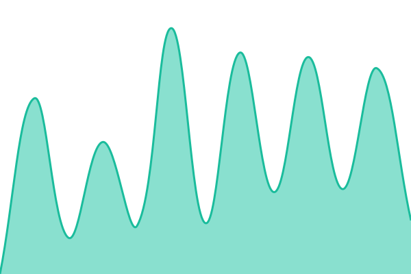 850ms
     
 | 

<a href="https://gujixiaojie.github.io/link-status/history/努努影院">100.00%</a>
    

|  [多多影视](https://323433ssdfd.top) | 🟩 Up | [多多影视.yml](https://github.com/gujixiaojie/link-status/commits/HEAD/history/多多影视.yml) | 

 280ms
     
 | 

<a href="https://gujixiaojie.github.io/link-status/history/多多影视">100.00%</a>
    

|  [奇点影视](https://qidianyingshi.net) | 🟩 Up | [奇点影视.yml](https://github.com/gujixiaojie/link-status/commits/HEAD/history/奇点影视.yml) | 

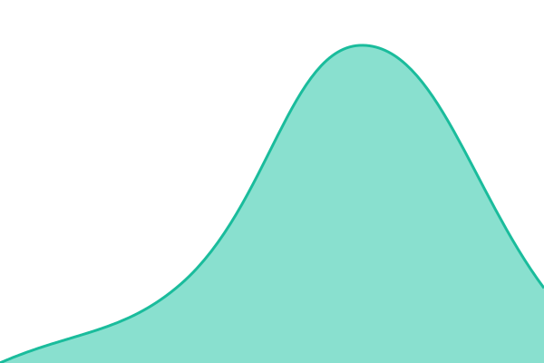 904ms
     
 | 

<a href="https://gujixiaojie.github.io/link-status/history/奇点影视">100.00%</a>
    

|  [VIP兔](https://www.viptu.com) | 🟩 Up | [vip.yml](https://github.com/gujixiaojie/link-status/commits/HEAD/history/vip.yml) | 

 1976ms
     
 | 

<a href="https://gujixiaojie.github.io/link-status/history/vip">100.00%</a>
    

|  [低端影视](https://ddys.io) | 🟩 Up | [低端影视.yml](https://github.com/gujixiaojie/link-status/commits/HEAD/history/低端影视.yml) | 

 186ms
     
 | 

<a href="https://gujixiaojie.github.io/link-status/history/低端影视">100.00%</a>
    

|  [蜻蜓电影](https://www.qtdy11.com) | 🟩 Up | [蜻蜓电影.yml](https://github.com/gujixiaojie/link-status/commits/HEAD/history/蜻蜓电影.yml) | 

 743ms
     
 | 

<a href="https://gujixiaojie.github.io/link-status/history/蜻蜓电影">100.00%</a>
    

|  [爱追剧影视](https://www.azj66.com) | 🟩 Up | [爱追剧影视.yml](https://github.com/gujixiaojie/link-status/commits/HEAD/history/爱追剧影视.yml) | 

 2432ms
     
 | 

<a href="https://gujixiaojie.github.io/link-status/history/爱追剧影视">100.00%</a>
    

|  [HDmoli](https://www.hdmoli.me) | 🟩 Up | [h-dmoli.yml](https://github.com/gujixiaojie/link-status/commits/HEAD/history/h-dmoli.yml) | 

 1404ms
     
 | 

<a href="https://gujixiaojie.github.io/link-status/history/h-dmoli">100.00%</a>
    

|  [琪琪影院](https://www.szxwwj.com) | 🟩 Up | [琪琪影院.yml](https://github.com/gujixiaojie/link-status/commits/HEAD/history/琪琪影院.yml) | 

 749ms
     
 | 

<a href="https://gujixiaojie.github.io/link-status/history/琪琪影院">100.00%</a>
    

|  [麦田影院](https://www.mtyy2.cc) | 🟩 Up | [麦田影院.yml](https://github.com/gujixiaojie/link-status/commits/HEAD/history/麦田影院.yml) | 

 1332ms
     
 | 

<a href="https://gujixiaojie.github.io/link-status/history/麦田影院">100.00%</a>
    

|  [好好看](https://www.hhkan1.com) | 🟥 Down | [好好看.yml](https://github.com/gujixiaojie/link-status/commits/HEAD/history/好好看.yml) | 

 1000ms
     
 | 

<a href="https://gujixiaojie.github.io/link-status/history/好好看">0.00%</a>
    

|  [Destiny-TV](https://www.tvfans.top) | 🟩 Up | [destiny-tv.yml](https://github.com/gujixiaojie/link-status/commits/HEAD/history/destiny-tv.yml) | 

 950ms
     
 | 

<a href="https://gujixiaojie.github.io/link-status/history/destiny-tv">100.00%</a>
    

|  [猩球影院](https://gorilla-flix.com) | 🟩 Up | [猩球影院.yml](https://github.com/gujixiaojie/link-status/commits/HEAD/history/猩球影院.yml) | 

 813ms
     
 | 

<a href="https://gujixiaojie.github.io/link-status/history/猩球影院">100.00%</a>
    

|  [在线之家](https://www.zxzj.run) | 🟩 Up | [在线之家.yml](https://github.com/gujixiaojie/link-status/commits/HEAD/history/在线之家.yml) | 

 254ms
     
 | 

<a href="https://gujixiaojie.github.io/link-status/history/在线之家">100.00%</a>
    

|  [FreeOK](https://www.freeokk.pro) | 🟥 Down | [free-ok.yml](https://github.com/gujixiaojie/link-status/commits/HEAD/history/free-ok.yml) | 

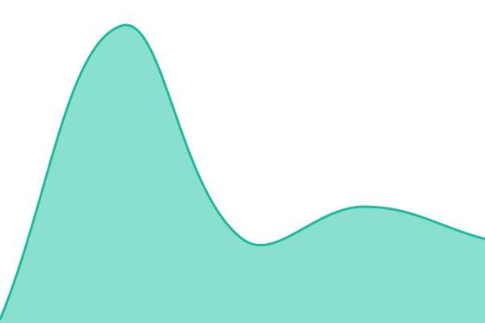 45ms
     
 | 

<a href="https://gujixiaojie.github.io/link-status/history/free-ok">0.00%</a>
    

|  [共青春](https://gqc.ink) | 🟥 Down | [共青春.yml](https://github.com/gujixiaojie/link-status/commits/HEAD/history/共青春.yml) | 

 531ms
     
 | 

<a href="https://gujixiaojie.github.io/link-status/history/共青春">0.00%</a>
    

|  [欧乐影院](https://www.oleol.com) | 🟩 Up | [欧乐影院.yml](https://github.com/gujixiaojie/link-status/commits/HEAD/history/欧乐影院.yml) | 

 168ms
     
 | 

<a href="https://gujixiaojie.github.io/link-status/history/欧乐影院">100.00%</a>
    

|  [蘑菇影视](https://moguvodw.com) | 🟩 Up | [蘑菇影视.yml](https://github.com/gujixiaojie/link-status/commits/HEAD/history/蘑菇影视.yml) | 

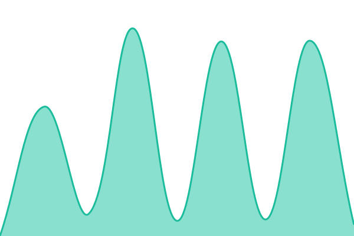 693ms
     
 | 

<a href="https://gujixiaojie.github.io/link-status/history/蘑菇影视">100.00%</a>
    

|  [66大片网](https://www.66dpw.vip) | 🟩 Up | [66.yml](https://github.com/gujixiaojie/link-status/commits/HEAD/history/66.yml) | 

 613ms
     
 | 

<a href="https://gujixiaojie.github.io/link-status/history/66">100.00%</a>
    

|  [555电影](https://5k40.top) | 🟩 Up | [555.yml](https://github.com/gujixiaojie/link-status/commits/HEAD/history/555.yml) | 

 872ms
     
 | 

<a href="https://gujixiaojie.github.io/link-status/history/555">100.00%</a>
    

|  [懂片帝AI](https://dongpian1.com) | 🟩 Up | [ai.yml](https://github.com/gujixiaojie/link-status/commits/HEAD/history/ai.yml) | 

 655ms
     
 | 

<a href="https://gujixiaojie.github.io/link-status/history/ai">100.00%</a>
    

|  [光速影视](https://yingshiso.link) | 🟩 Up | [光速影视.yml](https://github.com/gujixiaojie/link-status/commits/HEAD/history/光速影视.yml) | 

 1086ms
     
 | 

<a href="https://gujixiaojie.github.io/link-status/history/光速影视">100.00%</a>
    

|  [多瑙影院](https://dnvod.org) | 🟩 Up | [多瑙影院.yml](https://github.com/gujixiaojie/link-status/commits/HEAD/history/多瑙影院.yml) | 

 280ms
     
 | 

<a href="https://gujixiaojie.github.io/link-status/history/多瑙影院">100.00%</a>
    

|  [蓝光影院](https://www.touhaos.cc) | 🟩 Up | [蓝光影院.yml](https://github.com/gujixiaojie/link-status/commits/HEAD/history/蓝光影院.yml) | 

 1162ms
     
 | 

<a href="https://gujixiaojie.github.io/link-status/history/蓝光影院">100.00%</a>
    

|  [路飞影视](https://www.lufys.com) | 🟩 Up | [路飞影视.yml](https://github.com/gujixiaojie/link-status/commits/HEAD/history/路飞影视.yml) | 

 164ms
     
 | 

<a href="https://gujixiaojie.github.io/link-status/history/路飞影视">100.00%</a>
    

|  [大米星球](https://dmxq25.com) | 🟥 Down | [大米星球.yml](https://github.com/gujixiaojie/link-status/commits/HEAD/history/大米星球.yml) | 

 0ms
     
 | 

<a href="https://gujixiaojie.github.io/link-status/history/大米星球">0.00%</a>
    

|  [4K在线](https://www.bbibi.cc) | 🟩 Up | [4-k.yml](https://github.com/gujixiaojie/link-status/commits/HEAD/history/4-k.yml) | 

 1259ms
     
 | 

<a href="https://gujixiaojie.github.io/link-status/history/4-k">100.00%</a>
    

|  [网飞猫](https://www.ncat22.com) | 🟥 Down | [网飞猫.yml](https://github.com/gujixiaojie/link-status/commits/HEAD/history/网飞猫.yml) | 

 932ms
     
 | 

<a href="https://gujixiaojie.github.io/link-status/history/网飞猫">0.00%</a>
    

|  [糖豆影视](https://www.tdys.cc) | 🟩 Up | [糖豆影视.yml](https://github.com/gujixiaojie/link-status/commits/HEAD/history/糖豆影视.yml) | 

 1146ms
     
 | 

<a href="https://gujixiaojie.github.io/link-status/history/糖豆影视">100.00%</a>
    

|  [鱼塘社影视](https://tv.yutangshe.com) | 🟩 Up | [鱼塘社影视.yml](https://github.com/gujixiaojie/link-status/commits/HEAD/history/鱼塘社影视.yml) | 

 815ms
     
 | 

<a href="https://gujixiaojie.github.io/link-status/history/鱼塘社影视">14.29%</a>
    

|  [飞快TV](https://feikuai.in) | 🟩 Up | [tv.yml](https://github.com/gujixiaojie/link-status/commits/HEAD/history/tv.yml) | 

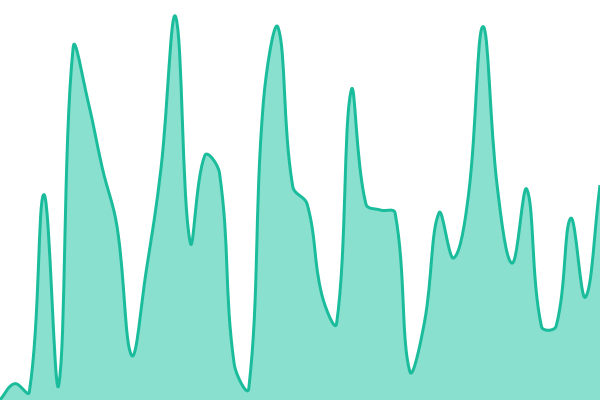 1096ms
     
 | 

<a href="https://gujixiaojie.github.io/link-status/history/tv">98.79%</a>
    

|  [爱奇艺](https://www.iqiyi.com) | 🟩 Up | [爱奇艺.yml](https://github.com/gujixiaojie/link-status/commits/HEAD/history/爱奇艺.yml) | 

 1120ms
     
 | 

<a href="https://gujixiaojie.github.io/link-status/history/爱奇艺">100.00%</a>
    

|  [腾讯视频](https://v.qq.com) | 🟩 Up | [腾讯视频.yml](https://github.com/gujixiaojie/link-status/commits/HEAD/history/腾讯视频.yml) | 

 1512ms
     
 | 

<a href="https://gujixiaojie.github.io/link-status/history/腾讯视频">100.00%</a>
    

|  [优酷](https://www.youku.com) | 🟩 Up | [优酷.yml](https://github.com/gujixiaojie/link-status/commits/HEAD/history/优酷.yml) | 

 12276ms
     
 | 

<a href="https://gujixiaojie.github.io/link-status/history/优酷">100.00%</a>
    

|  [PPTV](https://www.pptv.com) | 🟩 Up | [pptv.yml](https://github.com/gujixiaojie/link-status/commits/HEAD/history/pptv.yml) | 

 3290ms
     
 | 

<a href="https://gujixiaojie.github.io/link-status/history/pptv">100.00%</a>
    

|  [乐视视频](https://www.le.com) | 🟩 Up | [乐视视频.yml](https://github.com/gujixiaojie/link-status/commits/HEAD/history/乐视视频.yml) | 

 2292ms
     
 | 

<a href="https://gujixiaojie.github.io/link-status/history/乐视视频">100.00%</a>
    

|  [搜狐视频](https://tv.sohu.com) | 🟩 Up | [搜狐视频.yml](https://github.com/gujixiaojie/link-status/commits/HEAD/history/搜狐视频.yml) | 

 1295ms
     
 | 

<a href="https://gujixiaojie.github.io/link-status/history/搜狐视频">100.00%</a>
    

|  [360影视](https://www.360kan.com) | 🟥 Down | [360.yml](https://github.com/gujixiaojie/link-status/commits/HEAD/history/360.yml) | 

 0ms
     
 | 

<a href="https://gujixiaojie.github.io/link-status/history/360">0.00%</a>
    

|  [风行](https://www.fun.tv) | 🟩 Up | [风行.yml](https://github.com/gujixiaojie/link-status/commits/HEAD/history/风行.yml) | 

 2368ms
     
 | 

<a href="https://gujixiaojie.github.io/link-status/history/风行">100.00%</a>
    

|  [华数TV](https://www.wasu.cn) | 🟩 Up | [tv.yml](https://github.com/gujixiaojie/link-status/commits/HEAD/history/tv.yml) | 

 1096ms
     
 | 

<a href="https://gujixiaojie.github.io/link-status/history/tv">98.79%</a>
    

|  [柠檬视频](https://nmsp8.cc) | 🟥 Down | [柠檬视频.yml](https://github.com/gujixiaojie/link-status/commits/HEAD/history/柠檬视频.yml) | 

 42ms
     
 | 

<a href="https://gujixiaojie.github.io/link-status/history/柠檬视频">0.00%</a>
    

|  [56视频](https://www.56.com) | 🟩 Up | [56.yml](https://github.com/gujixiaojie/link-status/commits/HEAD/history/56.yml) | 

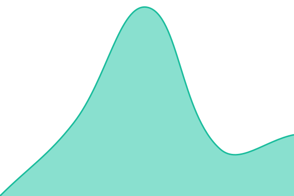 911ms
     
 | 

<a href="https://gujixiaojie.github.io/link-status/history/56">100.00%</a>
    

|  [人人影视](https://www.renren.pro) | 🟩 Up | [人人影视.yml](https://github.com/gujixiaojie/link-status/commits/HEAD/history/人人影视.yml) | 

 523ms
     
 | 

<a href="https://gujixiaojie.github.io/link-status/history/人人影视">100.00%</a>
    

|  [好看影视](https://hkys2.cc) | 🟥 Down | [好看影视.yml](https://github.com/gujixiaojie/link-status/commits/HEAD/history/好看影视.yml) | 

 38ms
     
 | 

<a href="https://gujixiaojie.github.io/link-status/history/好看影视">0.00%</a>
    

|  [两个BT影视](https://www.bttwo.org) | 🟩 Up | [bt.yml](https://github.com/gujixiaojie/link-status/commits/HEAD/history/bt.yml) | 

 1408ms
     
 | 

<a href="https://gujixiaojie.github.io/link-status/history/bt">100.00%</a>
    

|  [NO视频](https://www.novipnoad.net) | 🟥 Down | [no.yml](https://github.com/gujixiaojie/link-status/commits/HEAD/history/no.yml) | 

 52ms
     
 | 

<a href="https://gujixiaojie.github.io/link-status/history/no">0.01%</a>
    

|  [樱花影院](https://www.dcjyb.com) | 🟩 Up | [樱花影院.yml](https://github.com/gujixiaojie/link-status/commits/HEAD/history/樱花影院.yml) | 

 645ms
     
 | 

<a href="https://gujixiaojie.github.io/link-status/history/樱花影院">100.00%</a>
    

|  [蘑菇影视](https://www.5o5k.com) | 🟩 Up | [蘑菇影视.yml](https://github.com/gujixiaojie/link-status/commits/HEAD/history/蘑菇影视.yml) | 

 693ms
     
 | 

<a href="https://gujixiaojie.github.io/link-status/history/蘑菇影视">100.00%</a>
    

|  [抖音](https://www.douyin.com/vs) | 🟩 Up | [抖音.yml](https://github.com/gujixiaojie/link-status/commits/HEAD/history/抖音.yml) | 

 10645ms
     
 | 

<a href="https://gujixiaojie.github.io/link-status/history/抖音">100.00%</a>
    

|  [LIBVIO](https://www.libvio.pw) | 🟥 Down | [libvio.yml](https://github.com/gujixiaojie/link-status/commits/HEAD/history/libvio.yml) | 

 736ms
     
 | 

<a href="https://gujixiaojie.github.io/link-status/history/libvio">0.01%</a>
    

|  [低调影视](https://ddys.app) | 🟩 Up | [低调影视.yml](https://github.com/gujixiaojie/link-status/commits/HEAD/history/低调影视.yml) | 

 651ms
     
 | 

<a href="https://gujixiaojie.github.io/link-status/history/低调影视">100.00%</a>
    

|  [多多追剧](https://duoduozhuiju.com) | 🟩 Up | [多多追剧.yml](https://github.com/gujixiaojie/link-status/commits/HEAD/history/多多追剧.yml) | 

 245ms
     
 | 

<a href="https://gujixiaojie.github.io/link-status/history/多多追剧">100.00%</a>
    

|  [注视影视](https://gaze.host) | 🟩 Up | [注视影视.yml](https://github.com/gujixiaojie/link-status/commits/HEAD/history/注视影视.yml) | 

 1092ms
     
 | 

<a href="https://gujixiaojie.github.io/link-status/history/注视影视">100.00%</a>
    

|  [可可影视](https://www.kkys1.com) | 🟥 Down | [可可影视.yml](https://github.com/gujixiaojie/link-status/commits/HEAD/history/可可影视.yml) | 

 993ms
     
 | 

<a href="https://gujixiaojie.github.io/link-status/history/可可影视">0.00%</a>
    

|  [看片狂人](https://www.kpkuang.fun) | 🟩 Up | [看片狂人.yml](https://github.com/gujixiaojie/link-status/commits/HEAD/history/看片狂人.yml) | 

 158ms
     
 | 

<a href="https://gujixiaojie.github.io/link-status/history/看片狂人">100.00%</a>
    

|  [西瓜影院](https://jsntdl.com) | 🟩 Up | [西瓜影院.yml](https://github.com/gujixiaojie/link-status/commits/HEAD/history/西瓜影院.yml) | 

 282ms
     
 | 

<a href="https://gujixiaojie.github.io/link-status/history/西瓜影院">99.60%</a>
    

|  [SA视频](https://safilm69.com) | 🟩 Up | [sa.yml](https://github.com/gujixiaojie/link-status/commits/HEAD/history/sa.yml) | 

 1267ms
     
 | 

<a href="https://gujixiaojie.github.io/link-status/history/sa">100.00%</a>
    

|  [剧踪电影网](https://juzong.vip) | 🟥 Down | [剧踪电影网.yml](https://github.com/gujixiaojie/link-status/commits/HEAD/history/剧踪电影网.yml) | 

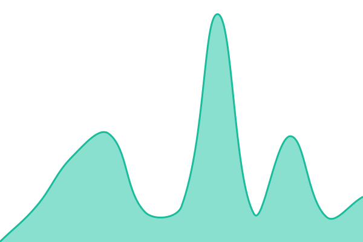 236ms
     
 | 

<a href="https://gujixiaojie.github.io/link-status/history/剧踪电影网">11.73%</a>
    

|  [小唐视频](https://xiaotie8.com) | 🟩 Up | [小唐视频.yml](https://github.com/gujixiaojie/link-status/commits/HEAD/history/小唐视频.yml) | 

 1004ms
     
 | 

<a href="https://gujixiaojie.github.io/link-status/history/小唐视频">100.00%</a>
    

|  [拾光影视](https://tv.time1080.xyz) | 🟩 Up | [拾光影视.yml](https://github.com/gujixiaojie/link-status/commits/HEAD/history/拾光影视.yml) | 

 695ms
     
 | 

<a href="https://gujixiaojie.github.io/link-status/history/拾光影视">100.00%</a>
    

|  [千千影视](https://www.qqys01.com) | 🟩 Up | [千千影视.yml](https://github.com/gujixiaojie/link-status/commits/HEAD/history/千千影视.yml) | 

 4888ms
     
 | 

<a href="https://gujixiaojie.github.io/link-status/history/千千影视">100.00%</a>
    

|  [绿色影视](https://lsysw.top) | 🟥 Down | [绿色影视.yml](https://github.com/gujixiaojie/link-status/commits/HEAD/history/绿色影视.yml) | 

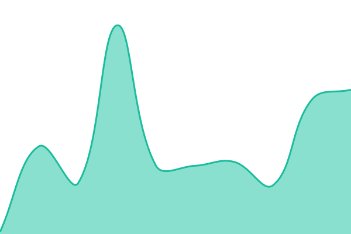 47ms
     
 | 

<a href="https://gujixiaojie.github.io/link-status/history/绿色影视">0.01%</a>
    

|  [AnyShort](https://anyshort.net/zh-Hant) | 🟩 Up | [any-short.yml](https://github.com/gujixiaojie/link-status/commits/HEAD/history/any-short.yml) | 

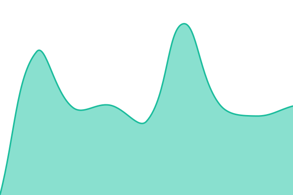 739ms
     
 | 

<a href="https://gujixiaojie.github.io/link-status/history/any-short">100.00%</a>
    

|  [找剧AI](https://zhaoju1.com) | 🟩 Up | [ai.yml](https://github.com/gujixiaojie/link-status/commits/HEAD/history/ai.yml) | 

 655ms
     
 | 

<a href="https://gujixiaojie.github.io/link-status/history/ai">100.00%</a>
    

|  [毒舌电影](https://www.dushe3.app) | 🟥 Down | [毒舌电影.yml](https://github.com/gujixiaojie/link-status/commits/HEAD/history/毒舌电影.yml) | 

 935ms
     
 | 

<a href="https://gujixiaojie.github.io/link-status/history/毒舌电影">0.00%</a>
    

|  [热播之家](https://www.rebozj.cc) | 🟩 Up | [热播之家.yml](https://github.com/gujixiaojie/link-status/commits/HEAD/history/热播之家.yml) | 

 1005ms
     
 | 

<a href="https://gujixiaojie.github.io/link-status/history/热播之家">100.00%</a>
    

|  [4k影视](https://www.4kvm.top) | 🟩 Up | [4k.yml](https://github.com/gujixiaojie/link-status/commits/HEAD/history/4k.yml) | 

 1390ms
     
 | 

<a href="https://gujixiaojie.github.io/link-status/history/4k">100.00%</a>
    

|  [宅男影视](https://zndy.top) | 🟩 Up | [宅男影视.yml](https://github.com/gujixiaojie/link-status/commits/HEAD/history/宅男影视.yml) | 

 1312ms
     
 | 

<a href="https://gujixiaojie.github.io/link-status/history/宅男影视">100.00%</a>
    

|  [茶杯虎](https://cuptgr.com) | 🟩 Up | [茶杯虎.yml](https://github.com/gujixiaojie/link-status/commits/HEAD/history/茶杯虎.yml) | 

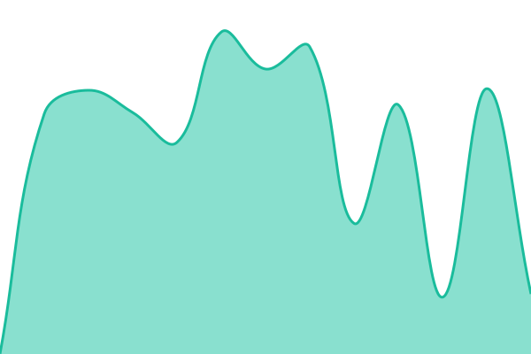 1304ms
     
 | 

<a href="https://gujixiaojie.github.io/link-status/history/茶杯虎">100.00%</a>
    

|  [番茄酱影视](https://fanqe.cc) | 🟩 Up | [番茄酱影视.yml](https://github.com/gujixiaojie/link-status/commits/HEAD/history/番茄酱影视.yml) | 

 620ms
     
 | 

<a href="https://gujixiaojie.github.io/link-status/history/番茄酱影视">100.00%</a>
    

|  [小唐短剧](https://bikamanhuaapp.com) | 🟩 Up | [小唐短剧.yml](https://github.com/gujixiaojie/link-status/commits/HEAD/history/小唐短剧.yml) | 

 1194ms
     
 | 

<a href="https://gujixiaojie.github.io/link-status/history/小唐短剧">100.00%</a>
    

|  [硬核指南](https://yinghezhinan.com) | 🟩 Up | [硬核指南.yml](https://github.com/gujixiaojie/link-status/commits/HEAD/history/硬核指南.yml) | 

 2770ms
     
 | 

<a href="https://gujixiaojie.github.io/link-status/history/硬核指南">100.00%</a>
    

|  [酷影聚](https://kyj1.cc) | 🟩 Up | [酷影聚.yml](https://github.com/gujixiaojie/link-status/commits/HEAD/history/酷影聚.yml) | 

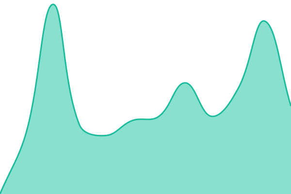 1696ms
     
 | 

<a href="https://gujixiaojie.github.io/link-status/history/酷影聚">100.00%</a>
    

|  [SOTVLA](https://www.sotvla.cc) | 🟩 Up | [sotvla.yml](https://github.com/gujixiaojie/link-status/commits/HEAD/history/sotvla.yml) | 

 223ms
     
 | 

<a href="https://gujixiaojie.github.io/link-status/history/sotvla">100.00%</a>
    

|  [厂长资源](https://www.cz4k.com) | 🟥 Down | [厂长资源.yml](https://github.com/gujixiaojie/link-status/commits/HEAD/history/厂长资源.yml) | 

 368ms
     
 | 

<a href="https://gujixiaojie.github.io/link-status/history/厂长资源">0.01%</a>
    

|  [LIBVIO](https://www.libvio.io) | 🟥 Down | [libvio.yml](https://github.com/gujixiaojie/link-status/commits/HEAD/history/libvio.yml) | 

 736ms
     
 | 

<a href="https://gujixiaojie.github.io/link-status/history/libvio">0.01%</a>
    

|  [西瓜影院](https://www.bzzdyy.com) | 🟩 Up | [西瓜影院.yml](https://github.com/gujixiaojie/link-status/commits/HEAD/history/西瓜影院.yml) | 

 282ms
     
 | 

<a href="https://gujixiaojie.github.io/link-status/history/西瓜影院">99.60%</a>
    

|  [NO视频](https://www.novipnoad.uk) | 🟥 Down | [no.yml](https://github.com/gujixiaojie/link-status/commits/HEAD/history/no.yml) | 

 52ms
     
 | 

<a href="https://gujixiaojie.github.io/link-status/history/no">0.01%</a>
    

|  [注视影视](https://gaze.red) | 🟩 Up | [注视影视.yml](https://github.com/gujixiaojie/link-status/commits/HEAD/history/注视影视.yml) | 

 1092ms
     
 | 

<a href="https://gujixiaojie.github.io/link-status/history/注视影视">100.00%</a>
    

|  [奈菲影视](https://www.nfyingshi.com) | 🟩 Up | [奈菲影视.yml](https://github.com/gujixiaojie/link-status/commits/HEAD/history/奈菲影视.yml) | 

 1321ms
     
 | 

<a href="https://gujixiaojie.github.io/link-status/history/奈菲影视">100.00%</a>
    

|  [大米星球](https://dmxq.fun) | 🟥 Down | [大米星球.yml](https://github.com/gujixiaojie/link-status/commits/HEAD/history/大米星球.yml) | 

 0ms
     
 | 

<a href="https://gujixiaojie.github.io/link-status/history/大米星球">0.00%</a>
    

|  [HDmoli](https://www.hdmoli.com) | 🟩 Up | [h-dmoli.yml](https://github.com/gujixiaojie/link-status/commits/HEAD/history/h-dmoli.yml) | 

 1404ms
     
 | 

<a href="https://gujixiaojie.github.io/link-status/history/h-dmoli">100.00%</a>
    

|  [雪糕TV](https://www.xgitv.com) | 🟩 Up | [tv.yml](https://github.com/gujixiaojie/link-status/commits/HEAD/history/tv.yml) | 

 1096ms
     
 | 

<a href="https://gujixiaojie.github.io/link-status/history/tv">98.79%</a>
    

|  [News-Today](https://vafvafnotif.com/static/wall.html) | 🟩 Up | [news-today.yml](https://github.com/gujixiaojie/link-status/commits/HEAD/history/news-today.yml) | 

 433ms
     
 | 

<a href="https://gujixiaojie.github.io/link-status/history/news-today">100.00%</a>
    

|  [厂长资源](https://www.4kcz.com) | 🟥 Down | [厂长资源.yml](https://github.com/gujixiaojie/link-status/commits/HEAD/history/厂长资源.yml) | 

 368ms
     
 | 

<a href="https://gujixiaojie.github.io/link-status/history/厂长资源">0.01%</a>
    

|  [努努影院](https://nnyy.in) | 🟩 Up | [努努影院.yml](https://github.com/gujixiaojie/link-status/commits/HEAD/history/努努影院.yml) | 

 850ms
     
 | 

<a href="https://gujixiaojie.github.io/link-status/history/努努影院">100.00%</a>
    

|  [纪录天堂](https://www.ummua.com) | 🟩 Up | [纪录天堂.yml](https://github.com/gujixiaojie/link-status/commits/HEAD/history/纪录天堂.yml) | 

 987ms
     
 | 

<a href="https://gujixiaojie.github.io/link-status/history/纪录天堂">100.00%</a>
    

|  [我爱纪录片](https://ilovedocu.com) | 🟩 Up | [我爱纪录片.yml](https://github.com/gujixiaojie/link-status/commits/HEAD/history/我爱纪录片.yml) | 

 249ms
     
 | 

<a href="https://gujixiaojie.github.io/link-status/history/我爱纪录片">100.00%</a>
    

|  [纪录片仓库](https://jilulib.com) | 🟩 Up | [纪录片仓库.yml](https://github.com/gujixiaojie/link-status/commits/HEAD/history/纪录片仓库.yml) | 

 239ms
     
 | 

<a href="https://gujixiaojie.github.io/link-status/history/纪录片仓库">100.00%</a>
    

|  [哔哩哔哩纪录片](https://www.bilibili.com/documentary) | 🟩 Up | [哔哩哔哩纪录片.yml](https://github.com/gujixiaojie/link-status/commits/HEAD/history/哔哩哔哩纪录片.yml) | 

 1020ms
     
 | 

<a href="https://gujixiaojie.github.io/link-status/history/哔哩哔哩纪录片">100.00%</a>
    

|  [央视片库](https://tv.cctv.com/yxg/index.shtml) | 🟩 Up | [央视片库.yml](https://github.com/gujixiaojie/link-status/commits/HEAD/history/央视片库.yml) | 

 634ms
     
 | 

<a href="https://gujixiaojie.github.io/link-status/history/央视片库">100.00%</a>
    

|  [追新番](https://www.fanxinzhui.com) | 🟩 Up | [追新番.yml](https://github.com/gujixiaojie/link-status/commits/HEAD/history/追新番.yml) | 

 490ms
     
 | 

<a href="https://gujixiaojie.github.io/link-status/history/追新番">100.00%</a>
    

|  [LiTV立視](https://www.litv.tv) | 🟩 Up | [li-tv.yml](https://github.com/gujixiaojie/link-status/commits/HEAD/history/li-tv.yml) | 

 2519ms
     
 | 

<a href="https://gujixiaojie.github.io/link-status/history/li-tv">100.00%</a>
    

|  [大木屋](https://www.damuwu.com) | 🟩 Up | [大木屋.yml](https://github.com/gujixiaojie/link-status/commits/HEAD/history/大木屋.yml) | 

 227ms
     
 | 

<a href="https://gujixiaojie.github.io/link-status/history/大木屋">100.00%</a>
    

|  [芒果TV](https://www.mgtv.com/live) | 🟩 Up | [tv.yml](https://github.com/gujixiaojie/link-status/commits/HEAD/history/tv.yml) | 

 1096ms
     
 | 

<a href="https://gujixiaojie.github.io/link-status/history/tv">98.79%</a>
    

|  [电视眼](https://www.tvyan.com) | 🟩 Up | [电视眼.yml](https://github.com/gujixiaojie/link-status/commits/HEAD/history/电视眼.yml) | 

 787ms
     
 | 

<a href="https://gujixiaojie.github.io/link-status/history/电视眼">100.00%</a>
    

|  [AcFun](https://www.acfun.cn) | 🟩 Up | [ac-fun.yml](https://github.com/gujixiaojie/link-status/commits/HEAD/history/ac-fun.yml) | 

 3439ms
     
 | 

<a href="https://gujixiaojie.github.io/link-status/history/ac-fun">85.90%</a>
    

|  [央视网视频](https://v.cctv.com) | 🟩 Up | [央视网视频.yml](https://github.com/gujixiaojie/link-status/commits/HEAD/history/央视网视频.yml) | 

 476ms
     
 | 

<a href="https://gujixiaojie.github.io/link-status/history/央视网视频">100.00%</a>
    

|  [哔哩哔哩](https://www.bilibili.com) | 🟩 Up | [哔哩哔哩.yml](https://github.com/gujixiaojie/link-status/commits/HEAD/history/哔哩哔哩.yml) | 

 1100ms
     
 | 

<a href="https://gujixiaojie.github.io/link-status/history/哔哩哔哩">100.00%</a>
    

|  [好看视频](https://haokan.baidu.com) | 🟩 Up | [好看视频.yml](https://github.com/gujixiaojie/link-status/commits/HEAD/history/好看视频.yml) | 

 1958ms
     
 | 

<a href="https://gujixiaojie.github.io/link-status/history/好看视频">100.00%</a>
    

|  [芒果TV](https://www.mgtv.com) | 🟩 Up | [tv.yml](https://github.com/gujixiaojie/link-status/commits/HEAD/history/tv.yml) | 

 1096ms
     
 | 

<a href="https://gujixiaojie.github.io/link-status/history/tv">98.79%</a>
    

|  [追剧吧](https://www.zhuiju8.cc) | 🟩 Up | [追剧吧.yml](https://github.com/gujixiaojie/link-status/commits/HEAD/history/追剧吧.yml) | 

 2066ms
     
 | 

<a href="https://gujixiaojie.github.io/link-status/history/追剧吧">100.00%</a>
    

|  [xb1电影](https://www.xb1.com) | 🟥 Down | [xb1.yml](https://github.com/gujixiaojie/link-status/commits/HEAD/history/xb1.yml) | 

 0ms
     
 | 

<a href="https://gujixiaojie.github.io/link-status/history/xb1">0.00%</a>
    

|  [壹秀影视](https://www.yixiuwang.com) | 🟩 Up | [壹秀影视.yml](https://github.com/gujixiaojie/link-status/commits/HEAD/history/壹秀影视.yml) | 

 1839ms
     
 | 

<a href="https://gujixiaojie.github.io/link-status/history/壹秀影视">100.00%</a>
    

|  [鸭鸭资源网](https://yayazy.org) | 🟩 Up | [鸭鸭资源网.yml](https://github.com/gujixiaojie/link-status/commits/HEAD/history/鸭鸭资源网.yml) | 

 176ms
     
 | 

<a href="https://gujixiaojie.github.io/link-status/history/鸭鸭资源网">100.00%</a>
    

|  [u酷资源站](https://ukuzy2.com) | 🟩 Up | [u.yml](https://github.com/gujixiaojie/link-status/commits/HEAD/history/u.yml) | 

 201ms
     
 | 

<a href="https://gujixiaojie.github.io/link-status/history/u">100.00%</a>
    

|  [快车资源网](https://kuaichezy.com) | 🟥 Down | [快车资源网.yml](https://github.com/gujixiaojie/link-status/commits/HEAD/history/快车资源网.yml) | 

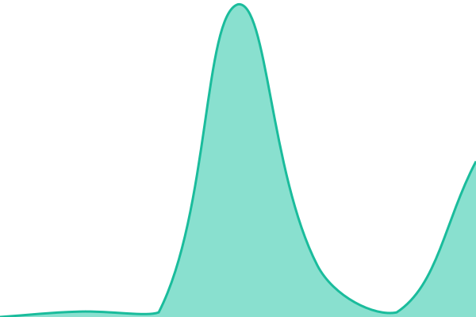 9562ms
     
 | 

<a href="https://gujixiaojie.github.io/link-status/history/快车资源网">62.72%</a>
    

|  [闪电资源网](https://shandianzy.com) | 🟩 Up | [闪电资源网.yml](https://github.com/gujixiaojie/link-status/commits/HEAD/history/闪电资源网.yml) | 

 490ms
     
 | 

<a href="https://gujixiaojie.github.io/link-status/history/闪电资源网">100.00%</a>
    

|  [无尽资源采集](https://wujinzy.cc) | 🟩 Up | [无尽资源采集.yml](https://github.com/gujixiaojie/link-status/commits/HEAD/history/无尽资源采集.yml) | 

 94ms
     
 | 

<a href="https://gujixiaojie.github.io/link-status/history/无尽资源采集">100.00%</a>
    

|  [红牛资源](https://www.hongniuziyuan.tv) | 🟩 Up | [红牛资源.yml](https://github.com/gujixiaojie/link-status/commits/HEAD/history/红牛资源.yml) | 

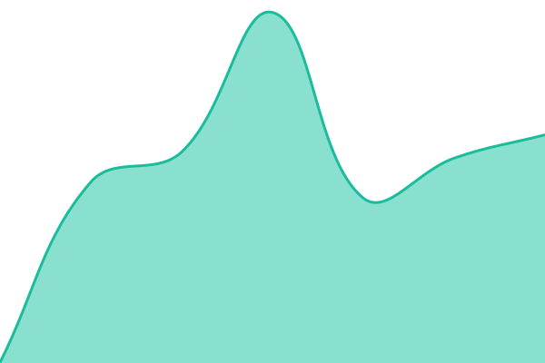 429ms
     
 | 

<a href="https://gujixiaojie.github.io/link-status/history/红牛资源">100.00%</a>
    

|  [麒麟资源站](https://www.qilinzyz.com) | 🟩 Up | [麒麟资源站.yml](https://github.com/gujixiaojie/link-status/commits/HEAD/history/麒麟资源站.yml) | 

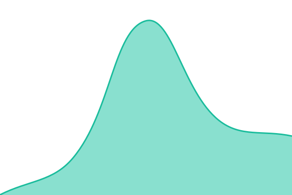 386ms
     
 | 

<a href="https://gujixiaojie.github.io/link-status/history/麒麟资源站">100.00%</a>
    

|  [冰豆云播](https://www.bingdou.vip) | 🟩 Up | [冰豆云播.yml](https://github.com/gujixiaojie/link-status/commits/HEAD/history/冰豆云播.yml) | 

 2509ms
     
 | 

<a href="https://gujixiaojie.github.io/link-status/history/冰豆云播">100.00%</a>
    

|  [兔子VIP视频解析站](https://htuzi.com/vip) | 🟩 Up | [vip.yml](https://github.com/gujixiaojie/link-status/commits/HEAD/history/vip.yml) | 

 1976ms
     
 | 

<a href="https://gujixiaojie.github.io/link-status/history/vip">100.00%</a>
    

|  [魔法影视](https://movie.mofaxi.cn) | 🟥 Down | [魔法影视.yml](https://github.com/gujixiaojie/link-status/commits/HEAD/history/魔法影视.yml) | 

 1143ms
     
 | 

<a href="https://gujixiaojie.github.io/link-status/history/魔法影视">10.57%</a>
    

|  [SeeNav全网VIP视频解析](https://movie.seenav.cn) | 🟩 Up | [see-nav-vip.yml](https://github.com/gujixiaojie/link-status/commits/HEAD/history/see-nav-vip.yml) | 

 1207ms
     
 | 

<a href="https://gujixiaojie.github.io/link-status/history/see-nav-vip">100.00%</a>
    

|  [粤漫之家](https://www.ymvid.com) | 🟩 Up | [粤漫之家.yml](https://github.com/gujixiaojie/link-status/commits/HEAD/history/粤漫之家.yml) | 

 974ms
     
 | 

<a href="https://gujixiaojie.github.io/link-status/history/粤漫之家">100.00%</a>
    

|  [酷影聚](https://feikuju.com) | 🟩 Up | [酷影聚.yml](https://github.com/gujixiaojie/link-status/commits/HEAD/history/酷影聚.yml) | 

 1696ms
     
 | 

<a href="https://gujixiaojie.github.io/link-status/history/酷影聚">100.00%</a>
    

|  [全民解析](https://www.quanminjiexi.com) | 🟩 Up | [全民解析.yml](https://github.com/gujixiaojie/link-status/commits/HEAD/history/全民解析.yml) | 

 788ms
     
 | 

<a href="https://gujixiaojie.github.io/link-status/history/全民解析">100.00%</a>
    

|  [追剧么](https://www.zhuijume.com/index.php/vod/type/id/1.html) | 🟩 Up | [追剧么.yml](https://github.com/gujixiaojie/link-status/commits/HEAD/history/追剧么.yml) | 

 772ms
     
 | 

<a href="https://gujixiaojie.github.io/link-status/history/追剧么">100.00%</a>
    

|  [看剧AI](https://kanju.ai) | 🟩 Up | [ai.yml](https://github.com/gujixiaojie/link-status/commits/HEAD/history/ai.yml) | 

 655ms
     
 | 

<a href="https://gujixiaojie.github.io/link-status/history/ai">100.00%</a>
    

|  [看看鸭](https://www.kankanya.me) | 🟩 Up | [看看鸭.yml](https://github.com/gujixiaojie/link-status/commits/HEAD/history/看看鸭.yml) | 

 569ms
     
 | 

<a href="https://gujixiaojie.github.io/link-status/history/看看鸭">100.00%</a>
    

|  [洛雪TV](https://tv.lxyy.club) | 🟩 Up | [tv.yml](https://github.com/gujixiaojie/link-status/commits/HEAD/history/tv.yml) | 

 1096ms
     
 | 

<a href="https://gujixiaojie.github.io/link-status/history/tv">98.79%</a>
    

|  [PPnix](https://www.ppnix.com/cn) | 🟩 Up | [p-pnix.yml](https://github.com/gujixiaojie/link-status/commits/HEAD/history/p-pnix.yml) | 

 439ms
     
 | 

<a href="https://gujixiaojie.github.io/link-status/history/p-pnix">100.00%</a>
    

|  [可可影视](https://www.kkys14.com) | 🟥 Down | [可可影视.yml](https://github.com/gujixiaojie/link-status/commits/HEAD/history/可可影视.yml) | 

 993ms
     
 | 

<a href="https://gujixiaojie.github.io/link-status/history/可可影视">0.00%</a>
    

|  [ZIP0](https://zip0.com) | 🟩 Up | [zip-0.yml](https://github.com/gujixiaojie/link-status/commits/HEAD/history/zip-0.yml) | 

 333ms
     
 | 

<a href="https://gujixiaojie.github.io/link-status/history/zip-0">100.00%</a>
    

|  [剧踪电影网](https://www.juzong01.me) | 🟥 Down | [剧踪电影网.yml](https://github.com/gujixiaojie/link-status/commits/HEAD/history/剧踪电影网.yml) | 

 236ms
     
 | 

<a href="https://gujixiaojie.github.io/link-status/history/剧踪电影网">11.73%</a>
    

|  [极速追剧](https://jisuzhuiju.com) | 🟩 Up | [极速追剧.yml](https://github.com/gujixiaojie/link-status/commits/HEAD/history/极速追剧.yml) | 

 1028ms
     
 | 

<a href="https://gujixiaojie.github.io/link-status/history/极速追剧">100.00%</a>
    

|  [片库](https://4k01.pianku.online) | 🟩 Up | [片库.yml](https://github.com/gujixiaojie/link-status/commits/HEAD/history/片库.yml) | 

 688ms
     
 | 

<a href="https://gujixiaojie.github.io/link-status/history/片库">100.00%</a>
    

|  [66大片网](https://www.77dpw.vip) | 🟩 Up | [66.yml](https://github.com/gujixiaojie/link-status/commits/HEAD/history/66.yml) | 

 613ms
     
 | 

<a href="https://gujixiaojie.github.io/link-status/history/66">100.00%</a>
    

|  [嘀嗒影视](https://www.didahd.xyz) | 🟩 Up | [嘀嗒影视.yml](https://github.com/gujixiaojie/link-status/commits/HEAD/history/嘀嗒影视.yml) | 

 680ms
     
 | 

<a href="https://gujixiaojie.github.io/link-status/history/嘀嗒影视">100.00%</a>
    

|  [追影](https://zhuiying3.cc) | 🟥 Down | [追影.yml](https://github.com/gujixiaojie/link-status/commits/HEAD/history/追影.yml) | 

 615ms
     
 | 

<a href="https://gujixiaojie.github.io/link-status/history/追影">0.01%</a>
    

|  [歪比巴卜](https://wbbb1.com) | 🟥 Down | [歪比巴卜.yml](https://github.com/gujixiaojie/link-status/commits/HEAD/history/歪比巴卜.yml) | 

 189ms
     
 | 

<a href="https://gujixiaojie.github.io/link-status/history/歪比巴卜">0.01%</a>
    

|  [开心影院](https://www.kxyy1.cc) | 🟥 Down | [开心影院.yml](https://github.com/gujixiaojie/link-status/commits/HEAD/history/开心影院.yml) | 

 634ms
     
 | 

<a href="https://gujixiaojie.github.io/link-status/history/开心影院">0.01%</a>
    

|  [豆花电影网](https://dhvideo.cc) | 🟩 Up | [豆花电影网.yml](https://github.com/gujixiaojie/link-status/commits/HEAD/history/豆花电影网.yml) | 

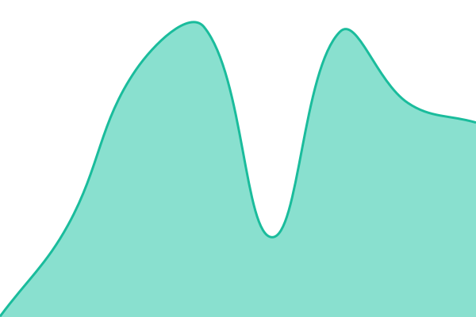 393ms
     
 | 

<a href="https://gujixiaojie.github.io/link-status/history/豆花电影网">100.00%</a>
    

|  [SA视频](https://www.lsjys11.com) | 🟩 Up | [sa.yml](https://github.com/gujixiaojie/link-status/commits/HEAD/history/sa.yml) | 

 1267ms
     
 | 

<a href="https://gujixiaojie.github.io/link-status/history/sa">100.00%</a>
    

|  [91毒舌电影](https://www.duse0.com) | 🟥 Down | [91.yml](https://github.com/gujixiaojie/link-status/commits/HEAD/history/91.yml) | 

 979ms
     
 | 

<a href="https://gujixiaojie.github.io/link-status/history/91">0.00%</a>
    

|  [Auete影视网](https://www.aeete.com) | 🟩 Up | [auete.yml](https://github.com/gujixiaojie/link-status/commits/HEAD/history/auete.yml) | 

 497ms
     
 | 

<a href="https://gujixiaojie.github.io/link-status/history/auete">100.00%</a>
    

|  [APP影院](https://www.appmovie.art) | 🟥 Down | [app.yml](https://github.com/gujixiaojie/link-status/commits/HEAD/history/app.yml) | 

 671ms
     
 | 

<a href="https://gujixiaojie.github.io/link-status/history/app">60.89%</a>
    

|  [来福吧](https://laifu8.com) | 🟩 Up | [来福吧.yml](https://github.com/gujixiaojie/link-status/commits/HEAD/history/来福吧.yml) | 

 668ms
     
 | 

<a href="https://gujixiaojie.github.io/link-status/history/来福吧">91.12%</a>
    

|  [奈飞工厂](https://www.netflixgc.com) | 🟩 Up | [奈飞工厂.yml](https://github.com/gujixiaojie/link-status/commits/HEAD/history/奈飞工厂.yml) | 

 292ms
     
 | 

<a href="https://gujixiaojie.github.io/link-status/history/奈飞工厂">100.00%</a>
    

|  [茶杯虎](https://www.725998.com/) | 🟩 Up | [茶杯虎.yml](https://github.com/gujixiaojie/link-status/commits/HEAD/history/茶杯虎.yml) | 

 1304ms
     
 | 

<a href="https://gujixiaojie.github.io/link-status/history/茶杯虎">100.00%</a>
    

|  [密码993xyz影视](https://123993.xyz/) | 🟩 Up | [993xyz.yml](https://github.com/gujixiaojie/link-status/commits/HEAD/history/993xyz.yml) | 

 202ms
     
 | 

<a href="https://gujixiaojie.github.io/link-status/history/993xyz">100.00%</a>
    

|  [酷云影院](https://www.kuyun123.com/) | 🟥 Down | [酷云影院.yml](https://github.com/gujixiaojie/link-status/commits/HEAD/history/酷云影院.yml) | 

 51ms
     
 | 

<a href="https://gujixiaojie.github.io/link-status/history/酷云影院">0.03%</a>
    

|  [河马短剧场](https://www.kuaikaw.cn/) | 🟩 Up | [河马短剧场.yml](https://github.com/gujixiaojie/link-status/commits/HEAD/history/河马短剧场.yml) | 

 3698ms
     
 | 

<a href="https://gujixiaojie.github.io/link-status/history/河马短剧场">100.00%</a>
    

|  [云播TV](https://www.ikanju.cc/) | 🟩 Up | [tv.yml](https://github.com/gujixiaojie/link-status/commits/HEAD/history/tv.yml) | 

 1096ms
     
 | 

<a href="https://gujixiaojie.github.io/link-status/history/tv">98.79%</a>
    

|  [爱看机器人](https://www.ikanbot.com/) | 🟩 Up | [爱看机器人.yml](https://github.com/gujixiaojie/link-status/commits/HEAD/history/爱看机器人.yml) | 

 104ms
     
 | 

<a href="https://gujixiaojie.github.io/link-status/history/爱看机器人">100.00%</a>
    

|  [茶杯狐](https://cupfox.app/) | 🟩 Up | [茶杯狐.yml](https://github.com/gujixiaojie/link-status/commits/HEAD/history/茶杯狐.yml) | 

 843ms
     
 | 

<a href="https://gujixiaojie.github.io/link-status/history/茶杯狐">100.00%</a>
    

<!--end: status pages-->

[**Visit our status website →**](https://gujixiaojie.github.io/link-status)

## 📄 License

- Powered by: [Upptime](https://github.com/upptime/upptime)
- Code: [MIT](./LICENSE) © [Anand Chowdhary](https://anandchowdhary.com)
- Data in the `./history` directory: [Open Database License](https://opendatacommons.org/licenses/odbl/1-0/)
